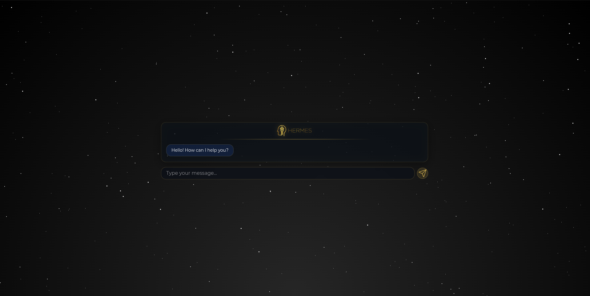
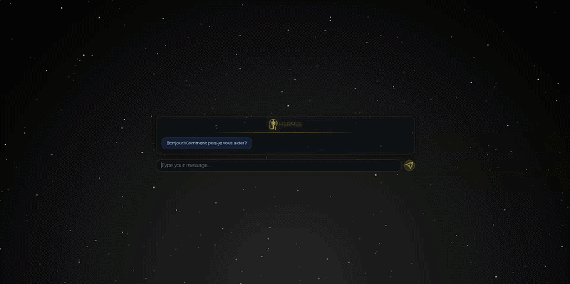
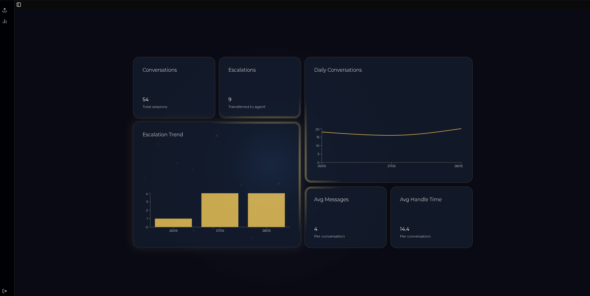
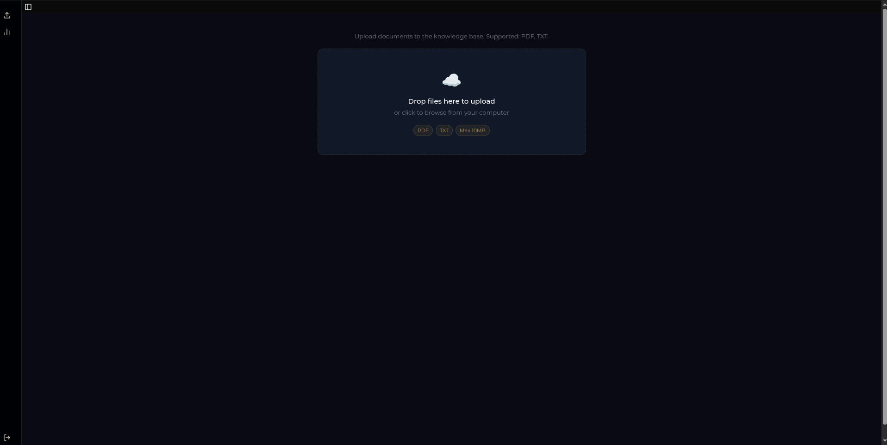
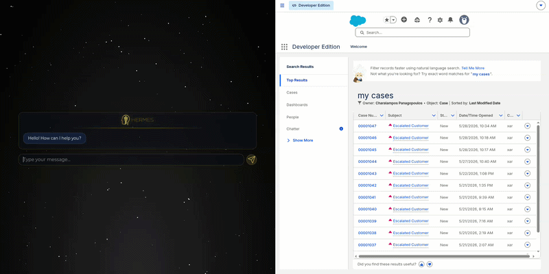

# Hermes — AI Customer Service Chatbot


Hermes is a production-ready AI chatbot built for **Lumio**, a fictional e-commerce platform. It combines a polished React frontend with a custom Node.js backend that implements Retrieval-Augmented Generation (RAG), token streaming over SSE, session tracking, and automatic human-handoff escalation.

The backend is private, but this README covers the full architecture so you can understand how everything fits together.



---

## Live Demo

**[hermes.cpanagopoulos.dev](https://hermes.cpanagopoulos.dev)**

Deployed on Vercel with a custom Cloudflare domain. The chatbot connects to the private Hermes backend running on a cloud server.

---

## Features

### Chat Interface



- **Real-time token streaming** — responses appear word-by-word via Server-Sent Events, no waiting for the full reply
- **Markdown rendering** — the AI can respond with formatted lists, bold text, and structured instructions
- **Session management** — each conversation gets a unique session ID, tracked on the backend
- **Animated message entry** — messages slide in with GSAP-powered transitions
- **Animated stars background** — WebGL-powered starfield rendered with OGL
- **Auto-scroll** — chat window follows new messages smoothly
- **End chat** — clears the session and starts a fresh one with a single click
- **Multilingual** — responds in the language the customer uses; optimised for English and Greek

### Admin Panel (JWT-protected)

| Stats Dashboard | Document Ingestion |
|---|---|
|  |  |

- **Stats dashboard** — bento-grid layout showing total sessions, escalation rate, containment rate, average messages per session, average handle time, and a 30-day daily chart
- **Document ingestion** — drag-and-drop interface to upload PDF or TXT files directly into the RAG knowledge base
- **Live polling** — stats refresh every 30 seconds automatically

### Escalation System



The AI detects when a customer mentions lawyers or formal complaints and flags the conversation for human review. When escalation is triggered:
1. The frontend fires a webhook with the full conversation history
2. The backend marks the session as escalated in the database
3. The UI reflects the escalated state

---

## Architecture

```
┌─────────────────────────────────────────────────────┐
│                     Browser                          │
│  React 19 + Vite  ──────────  Admin Panel           │
│  (this repo)            JWT auth + stats + ingest   │
└────────────────┬────────────────────────────────────┘
                 │  REST + SSE
┌────────────────▼────────────────────────────────────┐
│              Hermes Backend  (private)               │
│                                                      │
│  Express 5                                           │
│    ├── POST /api/chat          → SSE stream          │
│    ├── POST /api/session/start → UUID session        │
│    ├── POST /api/session/end   → mark ended          │
│    ├── POST /api/ingest        → RAG ingestion       │
│    ├── GET  /api/stats         → analytics           │
│    ├── POST /api/register      → admin auth          │
│    └── POST /api/login         → JWT issue           │
│                                                      │
│  RAG Pipeline                                        │
│    ├── PDF + TXT parsing (pdfjs-dist)                │
│    ├── Sentence-aware chunking with overlap          │
│    ├── OpenAI text-embedding-3-small                 │
│    └── pgvector cosine similarity search             │
│                                                      │
│  LLM Layer                                           │
│    ├── Groq (llama-3.1-8b-instant) — production     │
│    └── Ollama (local GGUF model) — development       │
│                                                      │
│  PostgreSQL                                          │
│    ├── sessions  (id, created_at, ended_at,          │
│    │              message_count, escalated)          │
│    ├── messages  (role, content, session_id)         │
│    └── documents (content, embedding, source)        │
└─────────────────────────────────────────────────────┘
```

---

## Backend Deep Dive

The backend is not public, but these are the non-trivial parts that were built from scratch:

### RAG Pipeline
Documents (PDF or plain text) are chunked using a sentence-aware algorithm with configurable size and overlap to avoid cutting mid-sentence. Each chunk is embedded with `text-embedding-3-small` and stored in PostgreSQL using the `pgvector` extension. At query time, the user message is embedded and the top-k most similar chunks (above a cosine similarity threshold) are injected into the system prompt as context.

The knowledge base used to train this instance is included in the [`knowledge-base/`](knowledge-base/) directory — two FAQ files covering Lumio's policies, shipping, returns, and account management, in both English and Greek.

### Streaming over SSE
The `/api/chat` endpoint streams the LLM response token by token using the OpenAI-compatible streaming API (works with both Ollama and Groq). Each token is serialized as an SSE `data:` event. A final `done` event carries the escalation flag. The frontend consumes this with the Streams API (`response.body.getReader()`), appending tokens directly to the last message in state — no buffering, no delay.

### Session Tracking
Every chat session gets a UUID. Messages are written to the database in real time (user message before LLM call, assistant message after). The `sessions` table records creation time, end time, message count, and escalation status, which feeds the admin stats dashboard.

### Escalation & Webhook
A regex runs on every completed LLM response. If it matches escalation keywords (`lawyer`, `complaint`, `human agent`, etc.), the backend sets `escalate: true` in the SSE done event. The frontend then POSTs the full conversation history to a configurable webhook URL (e.g. an n8n or Zapier automation).

### Rate Limiting
Two layers of rate limiting via `express-rate-limit`: a general 50 req / 15 min limit on all `/api` routes, and a stricter 10 req / 1 min limit on `/api/chat` specifically.

### Authentication
Admin routes (`/api/ingest`, `/api/stats`) are protected with JWT. Passwords are hashed with bcrypt. The frontend stores the token in `localStorage` and sends it as a `Bearer` header.

---

## Tech Stack

### Frontend
| | |
|---|---|
| Framework | React 19 |
| Build tool | Vite 8 |
| Styling | Tailwind CSS v4 + shadcn/ui |
| Animation | GSAP 3, Motion (Framer Motion), animate-ui |
| 3D / WebGL | OGL (stars background) |
| Markdown | react-markdown |
| Icons | lucide-react, @untitledui/icons |
| Font | Geist Variable |
| Deployment | Vercel |

### Backend
| | |
|---|---|
| Runtime | Node.js (ESM) |
| Framework | Express 5 |
| Database | PostgreSQL + pgvector |
| Embeddings | OpenAI text-embedding-3-small |
| LLM (prod) | Groq — llama-3.1-8b-instant |
| LLM (dev) | Ollama (local GGUF) |
| Auth | JWT + bcrypt |
| PDF parsing | pdfjs-dist |
| Rate limiting | express-rate-limit |
| Automation | n8n (escalation webhook) |

---

## Getting Started

### Prerequisites
- Node.js 20+
- pnpm
- A running instance of the Hermes backend (or your own compatible API)

### Installation

```bash
git clone https://github.com/your-username/hermes-frontend.git
cd hermes-frontend
pnpm install
```

### Environment Variables

Create a `.env` file in the project root:

```env
VITE_API_URL=https://your-backend-url.com
VITE_WEBHOOK_URL=https://your-webhook-url.com
```

| Variable | Description |
|---|---|
| `VITE_API_URL` | Base URL of the Hermes backend |
| `VITE_WEBHOOK_URL` | Webhook endpoint called on escalation |

### Run

```bash
pnpm dev
```

### Build

```bash
pnpm build
```

---

## Project Structure

```
src/
├── App.jsx                    # Root: session lifecycle + SSE chat logic
├── components/
│   ├── Chat/
│   │   ├── Chat.jsx           # Message list, loading indicator, end button
│   │   └── WelcomeMessage.jsx # Shown before first message
│   ├── Controls/
│   │   └── Controls.jsx       # Input field + send button
│   ├── Admin/
│   │   ├── Admin.jsx          # Sidebar layout (stats / documents)
│   │   ├── Stats.jsx          # Fetches + displays analytics
│   │   ├── Documents.jsx      # Drag-and-drop RAG ingestion UI
│   │   └── MagicBento/        # Bento grid with spotlight effects
│   ├── Login/
│   │   └── Login.jsx          # JWT login form
│   ├── animate-ui/            # Animation primitives and animated icons
│   └── ui/                    # shadcn components + custom wrappers
├── hooks/                     # Reusable React hooks
└── lib/                       # Utility functions
```

---

## License

MIT
